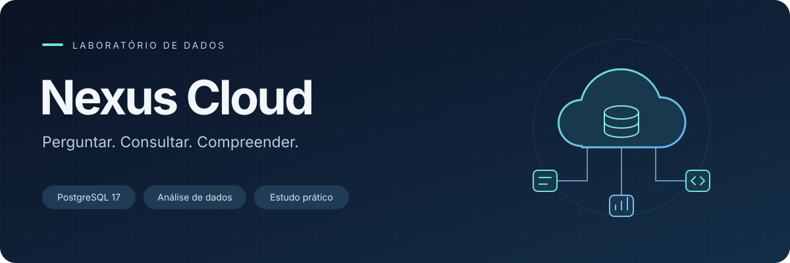

<p align="center">
  
</p>

<p align="center">
  
  
  
  
  
  
</p>

# Nexus Cloud · Analytics Engineering & Data Intelligence

**Quanto a provedora de nuvem vendeu, quanto cobrou e quanto de fato entrou no caixa?**

Na Nexus Cloud, uma empresa fictícia de infraestrutura B2B, um cliente pode contratar um banco de dados em janeiro, receber uma cobrança em fevereiro e pagá-la em março. Para o comercial, janeiro marca uma nova contratação. Para o financeiro, o dinheiro entra em março. As 25 consultas em PostgreSQL acompanham esse percurso, da carteira de serviços ao recebimento de cada cobrança.

[Explorar as consultas](docs/02-desafios-sql.md) · [Ver as entregas e os CSVs](docs/03-progresso.md) · [Abrir os notebooks](notebooks/README.md)

## 📌 Sumário executivo

A base sintética reúne 1.000 clientes e 5.000 contratos. A série de recebimentos cobre novembro de 2023 a outubro de 2026. O saldo em atraso e a estimativa mensal retratam a situação da carteira na exportação.

| Pergunta de negócio | Resultado | Fonte |
| --- | --- | --- |
| Quanto entrou no caixa em 36 meses? | **R$ 6.858.603,06**. As somas por mês, categoria e setor coincidem. | [Por mês](reports/relatorios_financeiros/13_receita_mensal_recebida.csv) · [Por setor](reports/analise_avancada/23_receita_recebida_por_setor.csv) |
| Qual categoria mais contribuiu para a receita? | **Banco de dados**, com R$ 3.196.190,92, ou **46,60%** do total recebido. | [Receita por categoria](reports/relatorios_financeiros/16_receita_recebida_por_categoria.csv) |
| Quanto estava em atraso na carteira exportada? | **R$ 1.308.648,71** em 4.740 cobranças de 660 clientes. Isso equivale a **15,37%** dos R$ 8.515.680,85 cobrados. | [Saldo por cliente](reports/relatorios_financeiros/14_clientes_cobrancas_atrasadas.csv) · [Taxa por valor](reports/relatorios_financeiros/17_taxa_inadimplencia.csv) |
| Quanto a carteira ativa representa por mês? | **R$ 1.065.381,00** contratados. Aplicando o custo atual dos serviços, de R$ 567.879,11, a diferença mensal estimada é de **R$ 497.501,89**. | [Estimativa da carteira ativa](reports/relatorios_financeiros/18_receita_contratada_custos_operacionais.csv) |

## 🚀 Trilha analítica

**01–05 · Conhecendo a empresa.** São Paulo concentra 297 dos 1.000 clientes cadastrados. A mesma etapa examina o que a provedora tem para oferecer, dos preços do catálogo aos 95,74 TB de armazenamento nos 27 servidores ativos. [Clientes por estado](reports/conhecendo_a_empresa/01_distribuicao_geografica_clientes.csv) · [Infraestrutura ativa](reports/conhecendo_a_empresa/04_infraestrutura_servidores_ativos.csv)

**06–12 · Contratos e operações.** Há duas populações distintas por trás de “clientes sem contrato ativo”. Na base exportada, 184 empresas nunca contrataram um serviço. Outras 20 já contrataram, mas na data da exportação só tinham contratos suspensos ou cancelados. [Sem contratação histórica](reports/relacionamentos_e_operacoes/07_clientes_sem_contratos.csv) · [Com histórico e sem contrato ativo](reports/relacionamentos_e_operacoes/12_clientes_sem_contratos_ativos.csv)

**13–19 · Receita e concentração.** Banco de dados responde por quase metade da receita. Quando a pergunta muda de *qual categoria gera receita* para *quem paga*, os cinco maiores clientes, somados, representam 5,67% de todo o valor recebido. [Participação por categoria](reports/relatorios_financeiros/16_receita_recebida_por_categoria.csv) · [Concentração nos cinco maiores clientes](reports/relatorios_financeiros/19_concentracao_receita_cinco_clientes_conjunta.csv)

**20–25 · Evolução e comportamento de pagamento.** As séries mensais acompanham novas contratações e variação da receita. Dos 5.000 contratos, 816 constam como cancelados (16,32% do histórico). Entre as 7.107 cobranças quitadas após o vencimento, o atraso médio foi de **26,67 dias**. [Evolução da receita](reports/analise_avancada/22_crescimento_receita_mensal.csv) · [Cancelamentos](reports/analise_avancada/21_contratos_cancelados.csv) · [Dias de atraso](reports/analise_avancada/24_pagamentos_atrasados_media_dias.csv)

**26–30 · Diagnósticos visuais e painel.** Os notebooks de [diagnóstico comercial](notebooks/26-diagnostico-comercial.ipynb) e [receita por categoria](notebooks/27-mix-receita-categorias.ipynb) já têm gráficos salvos e aguardam interpretação e validação. A segmentação da carteira e a análise de risco têm enunciados definidos. O Streamlit exibe a página inicial, e os indicadores estão descritos na [especificação do painel](docs/04-visualizacoes-dashboard.md).

## 🏗️ Modelo de dados e regras de negócio

<p align="center">
  
</p>

Cada linha de `nexus.contratos` liga um cliente a um serviço. Como um contrato pode gerar várias cobranças em `nexus.pagamentos`, somar a mensalidade depois de juntar essas tabelas pode multiplicar a receita contratada. O relatório 18 conta cada contrato ativo uma vez e usa o preço e o custo atuais de `nexus.servico`. Já a receita recebida usa o valor da cobrança paga e sua data efetiva de pagamento.

O modelo usa `NUMERIC(10,2)` para valores monetários e admite uma cobrança por contrato e data de vencimento. Os servidores têm cadastro independente, sem vínculo que permita ratear seu custo por contrato. [Modelo SQL](sql/models/model.sql) · [Regras de negócio](docs/01-contexto-negocio.md)

## 🛠️ Tecnologias e organização

| Etapa | Tecnologias | Onde explorar |
| --- | --- | --- |
| Gerar e armazenar os dados | Python, PostgreSQL 17 e Docker Compose | [Gerador e instruções de carga](seeds/README.md) |
| Consultar a carteira e os recebimentos | SQL, CTEs e funções de janela | [Consultas](sql/analysis/) · [Resultados em CSV](reports/) |
| Explorar e visualizar | Jupyter, pandas, Matplotlib e acesso ao PostgreSQL via SQLAlchemy e psycopg | [Notebooks](notebooks/) |
| Apresentar os indicadores previstos | Streamlit | [Página inicial do painel](dashboards/app.py) |

A revisão das consultas e análises conta com assistência de IA e segue os [critérios de validação do projeto](docs/05-criterios-correcao.md).

## ⚙️ Execução local

Para o banco e a carga, são necessários Docker e Docker Compose com suporte a `docker compose wait`. Para notebooks e Streamlit, use Python 3.13 ou superior e uv. Execute os comandos a partir da raiz do repositório.

```bash
git clone https://github.com/Victor-TelesF/Nexus-Cloud.git
cd Nexus-Cloud
cp .env.example .env
```

Configure as credenciais em `.env`, substituindo a senha de exemplo. Em seguida:

```bash
docker compose up -d --build
docker compose wait seed
docker compose logs seed
uv sync --locked
```

O PostgreSQL fica disponível em `127.0.0.1:5500` por padrão, com porta configurável por `POSTGRES_PORT`. Entre os serviços Docker, o endereço é `db:5432`. Na primeira carga de uma base vazia, o gerador insere 1.000 clientes, 20 serviços, 5.000 contratos, 30.000 cobranças e 30 servidores. Se qualquer tabela já tiver registros, a carga com `--if-empty` é ignorada. Os [detalhes da carga](seeds/README.md) explicam parâmetros, manifesto e persistência dos volumes.

Para executar SQL, conecte um cliente PostgreSQL com as credenciais de `.env` e abra os arquivos de `sql/analysis/`. Nos arquivos 18 e 19, a segunda consulta produz, respectivamente, a estimativa mensal da carteira ativa e a participação individual dos cinco maiores clientes. A exportação dos resultados em CSV não é automatizada por um comando do repositório.

No VS Code, abra a pasta inteira e selecione o kernel de `.venv` nos notebooks. A configuração local usa a raiz do projeto como diretório de execução. O [guia de ambiente](docs/06-ambiente-analise.md) descreve as extensões e tarefas disponíveis.

Para abrir a página inicial do Streamlit:

```bash
uv run --locked python -m streamlit run dashboards/app.py
```

A página fica em `http://127.0.0.1:8501`. Esse comando inicia a estrutura atual do painel, cujos indicadores ainda serão implementados.

## Documentação

- [Contexto e regras de negócio](docs/01-contexto-negocio.md)
- [Catálogo de consultas e perguntas analíticas](docs/02-desafios-sql.md)
- [Situação e arquivos dos 30 desafios](docs/03-progresso.md)
- [Especificação de visualizações e dashboard](docs/04-visualizacoes-dashboard.md)
- [Critérios de validação analítica](docs/05-criterios-correcao.md)
- [Ambiente Jupyter, VS Code e Streamlit](docs/06-ambiente-analise.md)
- [Notebooks](notebooks/README.md) e [geração de dados sintéticos](seeds/README.md)

## Licença

O repositório não contém um arquivo de licença. Não há uma licença de uso ou redistribuição declarada nesta versão.
