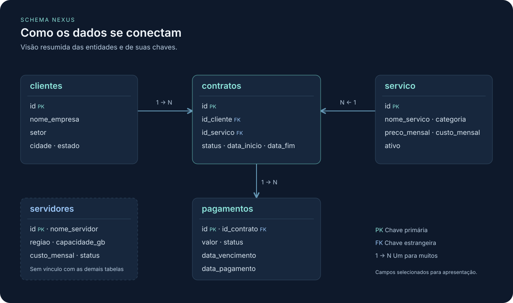

<p align="center">
  
</p>

# Nexus Cloud

Projeto de análise de dados de uma empresa fictícia de infraestrutura em nuvem B2B. O banco PostgreSQL armazena clientes, serviços, contratos e cobranças; as consultas SQL analisam a carteira comercial, a receita recebida e os pagamentos em atraso.

O trabalho reúne modelagem relacional, geração de dados sintéticos, 25 consultas SQL e análises em Python/pandas. As visualizações em Jupyter estão em desenvolvimento. A aplicação Streamlit contém a página inicial; os indicadores do painel ainda estão planejados.

A revisão das consultas e análises conta com assistência de IA e segue os [critérios de validação do projeto](docs/05-criterios-correcao.md).

## Contexto de negócio

Um cliente pode contratar vários serviços, e cada contrato pode gerar várias cobranças. O projeto investiga a composição dessa carteira, a evolução das contratações e a concentração dos recebimentos. As análises distinguem receita mensal contratada, valor cobrado e dinheiro efetivamente recebido.

A [documentação do domínio](docs/01-contexto-negocio.md) define como tratar atividade dos contratos, datas de pagamento, inadimplência e custos estimados. O [catálogo analítico](docs/02-desafios-sql.md) reúne as perguntas e os arquivos correspondentes.

## Tecnologias

- PostgreSQL 17 em Docker Compose para persistência e consultas analíticas.
- Python 3.13 ou superior, pandas e NumPy para leitura e análise dos dados.
- Jupyter no VS Code, Matplotlib e seaborn para exploração e visualização.
- SQLAlchemy e psycopg para acesso ao banco; Pydantic Settings para configuração local.
- Streamlit para o painel em desenvolvimento e uv para gerenciar o ambiente Python.

Os requisitos estão em [pyproject.toml](pyproject.toml), com versões resolvidas em [uv.lock](uv.lock). O contêiner de carga usa Python 3.13; PostgreSQL usa a imagem `postgres:17`.

## Arquitetura e modelo

O serviço `seed` gera os dados e inicializa o schema `nexus` em uma base vazia. As consultas em `sql/analysis/` têm resultados exportados em `reports/`. Os notebooks consomem esses CSVs e também consultam o PostgreSQL. O Compose inicia o banco e a carga; Jupyter e Streamlit executam no ambiente Python local.

<p align="center">
  
</p>

O modelo tem cinco tabelas: `clientes`, `servico`, `contratos`, `pagamentos` e `servidores`. Clientes e serviços se relacionam por contratos; cobranças apontam para contratos. Servidores têm cadastro independente, sem vínculo que permita ratear seu custo por contrato.

O [DDL](sql/models/model.sql) define chaves primárias e estrangeiras, valores monetários `NUMERIC(10,2)`, restrições de status e datas, e unicidade do par contrato/vencimento. Preços e custos do catálogo não têm histórico de versões.

## Análises e resultados disponíveis

**Todos os valores abaixo vêm de dados sintéticos.** Os CSVs disponíveis abrangem recebimentos de novembro de 2023 a outubro de 2026. Os totais foram conferidos entre os arquivos exportados. Uma nova carga ou data de execução pode produzir outros resultados.

- **Receita recebida:** R$ 6.858.603,06 em 36 meses. As somas por mês, categoria e setor coincidem. Fontes: relatórios [13](reports/relatorios_financeiros/13_receita_mensal_recebida.csv), [16](reports/relatorios_financeiros/16_receita_recebida_por_categoria.csv) e [23](reports/analise_avancada/23_receita_recebida_por_setor.csv).
- **Composição da receita:** Banco de dados representa R$ 3.196.190,92, ou 46,60% dos recebimentos do histórico. Fonte: [receita por categoria](reports/relatorios_financeiros/16_receita_recebida_por_categoria.csv).
- **Cobranças em atraso:** R$ 1.308.648,71 em 4.740 cobranças de 660 clientes. O valor corresponde a 15,37% dos R$ 8.515.680,85 de todas as cobranças registradas na fotografia exportada. Fontes: relatórios [14](reports/relatorios_financeiros/14_clientes_cobrancas_atrasadas.csv) e [17](reports/relatorios_financeiros/17_taxa_inadimplencia.csv).
- **Estimativa mensal contratada:** R$ 1.065.381,00 de receita contratada e R$ 567.879,11 de custo estimado, com diferença de R$ 497.501,89. O cálculo usa preços e custos atuais por contrato administrativamente ativo; não apura lucro operacional nem caixa realizado. Fonte: [relatório 18](reports/relatorios_financeiros/18_receita_contratada_custos_operacionais.csv).
- **Contratos cancelados:** 816 entre 5.000 contratos registrados, ou 16,32%. É uma proporção do histórico por status atual, sem janela de cancelamento ou denominador de clientes; não representa logo churn. Fonte: [relatório 21](reports/analise_avancada/21_contratos_cancelados.csv).

## Estado atual

As consultas 01–25 estão implementadas, com 30 CSVs disponíveis, pois alguns arquivos contêm mais de uma consulta. O [resumo dos 30 desafios](docs/03-progresso.md) reúne a situação e os arquivos de cada entrega.

Os notebooks [26](notebooks/26-diagnostico-comercial.ipynb) e [27](notebooks/27-mix-receita-categorias.ipynb) contêm código e gráficos salvos, com validação analítica e interpretação ainda pendentes. Os notebooks [28](notebooks/28-segmentacao-carteira.ipynb) e [29](notebooks/29-monitoramento-risco.ipynb) contêm somente o escopo previsto. O [painel](dashboards/app.py) exibe o título do projeto e ainda não tem consultas, métricas ou filtros.

O próximo trabalho previsto é concluir e validar as análises visuais, implementar a segmentação e o risco financeiro e reunir os indicadores no Streamlit, conforme a [especificação visual](docs/04-visualizacoes-dashboard.md).

## Execução local

Para o banco e a carga, são necessários Docker e Docker Compose com suporte a `docker compose wait`. Para notebooks e Streamlit, use Python 3.13 ou superior e uv. Execute os comandos a partir da raiz do repositório.

```bash
git clone https://github.com/Victor-TelesF/Nexus-Cloud.git
cd Nexus-Cloud
cp .env.example .env
```

Configure as credenciais em `.env`, substituindo a senha de exemplo. Em seguida:

```bash
docker compose up -d --build
docker compose wait seed
docker compose logs seed
uv sync --locked
```

O PostgreSQL fica disponível em `127.0.0.1:5500` por padrão, com porta configurável por `POSTGRES_PORT`. Entre os serviços Docker, o endereço é `db:5432`. Na primeira carga de uma base vazia, o gerador insere 1.000 clientes, 20 serviços, 5.000 contratos, 30.000 cobranças e 30 servidores. Se qualquer tabela já tiver registros, a carga com `--if-empty` é ignorada. Os [detalhes da carga](seeds/README.md) explicam parâmetros, manifesto e persistência dos volumes.

Para executar SQL, conecte um cliente PostgreSQL com as credenciais de `.env` e abra os arquivos de `sql/analysis/`. Nos arquivos 18 e 19, a segunda consulta produz, respectivamente, a estimativa mensal da carteira ativa e a participação individual dos cinco maiores clientes. A exportação dos resultados em CSV não é automatizada por um comando do repositório.

No VS Code, abra a pasta inteira e selecione o kernel de `.venv` nos notebooks. A configuração local usa a raiz do projeto como diretório de execução. O [guia de ambiente](docs/06-ambiente-analise.md) descreve as extensões e tarefas disponíveis.

Para abrir a página inicial do Streamlit:

```bash
uv run --locked python -m streamlit run dashboards/app.py
```

A página fica em `http://127.0.0.1:8501`. Esse comando inicia a estrutura atual do painel, cujos indicadores ainda serão implementados.

## Documentação

- [Contexto e regras de negócio](docs/01-contexto-negocio.md)
- [Catálogo de consultas e perguntas analíticas](docs/02-desafios-sql.md)
- [Situação e arquivos dos 30 desafios](docs/03-progresso.md)
- [Especificação de visualizações e dashboard](docs/04-visualizacoes-dashboard.md)
- [Critérios de validação analítica](docs/05-criterios-correcao.md)
- [Ambiente Jupyter, VS Code e Streamlit](docs/06-ambiente-analise.md)
- [Notebooks](notebooks/README.md) e [geração de dados sintéticos](seeds/README.md)

## Licença

O repositório não contém um arquivo de licença. Não há uma licença de uso ou redistribuição declarada nesta versão.
