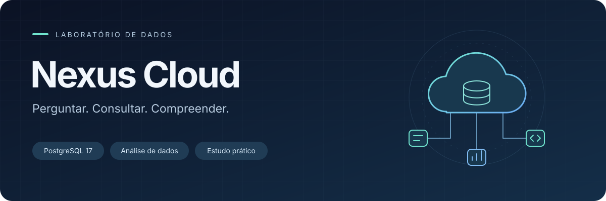

<p align="center">
  
</p>

# Nexus Cloud

Como distinguir o que uma empresa de nuvem vendeu, o que cobrou e o que de fato recebeu? Neste laboratório, você responde a pedidos do comercial, do financeiro e da infraestrutura usando dados fictícios da Nexus Cloud. O percurso tem 25 relatórios em PostgreSQL, quatro análises com gráficos e um dashboard executivo.

| Para… | Abra |
| --- | --- |
| Escolher um relatório e entender o pedido | [Os 30 desafios](docs/02-desafios-sql.md) |
| Retomar a última tentativa ou pedir revisão | [Checklist e evidências](docs/03-progresso.md) |
| Consultar o modelo e as regras de negócio | [Contexto da Nexus Cloud](docs/01-contexto-negocio.md) |
| Preparar os gráficos e o painel | [Entregáveis visuais](docs/04-visualizacoes-dashboard.md) |
| Entender como uma entrega será avaliada | [Critérios de correção](docs/05-criterios-correcao.md) |

## Trabalhar no ambiente local

1. Instale Docker com Compose. Na primeira configuração, copie `.env.example` para `.env` e defina as credenciais.
2. Na raiz do repositório, inicie o ambiente e aguarde a carga:

   ```bash
   docker compose up -d --build
   docker compose wait seed
   docker compose logs seed
   ```

   O PostgreSQL 17 inicia primeiro. Depois, o serviço `seed` cria o schema `nexus`, aplica o [modelo SQL](sql/models/model.sql) e popula uma base vazia com dados fictícios. A carga contém 1.000 clientes, 20 serviços, 5.000 contratos, 30.000 cobranças e 30 servidores. O serviço `seed` termina com código `0` quando conclui; isso é esperado.
3. No VS Code, conecte a extensão PostgreSQL da Microsoft a `127.0.0.1`, usando o banco, o usuário, a senha e a porta do seu `.env` (padrão 5432).
4. Abra a [pasta de consultas](sql/analysis/), execute sua tentativa e compare as linhas retornadas com o pedido. Para pedir feedback ao Codex no repositório, escreva, por exemplo, **“Revise o relatório 12 e me dê uma pista para testar minha lógica.”** O fluxo está em [AGENTS.md](AGENTS.md).

Ao iniciar novamente, a carga automática verifica se há dados e os preserva, sem duplicá-los. Para encerrar o ambiente mantendo os volumes, use `docker compose down`. Para iniciar somente o banco, sem executar a carga, use `docker compose up -d db`. Os parâmetros de simulação, reprodutibilidade e execução local estão no [guia da carga](seeds/README.md).

Na etapa visual, o [ambiente Python](pyproject.toml) inclui pandas, Matplotlib e seaborn. O roteiro recomenda Power BI para o painel final e admite uma biblioteca gráfica em Python.
