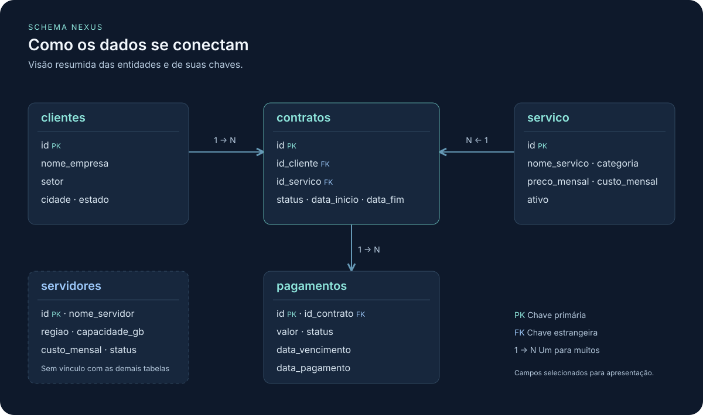

# A empresa e os dados

A Nexus Cloud vende infraestrutura para outras empresas. Uma cliente pode hospedar uma aplicação, contratar um banco gerenciado e aumentar o armazenamento em momentos diferentes. Cada contratação gera um contrato, e o mesmo contrato pode originar diversas cobranças mensais. Essa distinção determina o que contar quando o comercial pede “quantos contratos” e o financeiro pede “quanto recebemos”.

| Tabela | O que uma linha representa | Detalhe relevante para o relatório |
| --- | --- | --- |
| `nexus.clientes` | Uma empresa cadastrada | Cadastro pode existir sem contrato. O identificador distingue empresas de nomes iguais. |
| `nexus.servico` | Uma oferta do catálogo | Preço e custo são mensais e atuais. A disponibilidade do catálogo está em `ativo`. |
| `nexus.contratos` | Uma contratação de um serviço por um cliente | Há data de início, fim opcional e situação administrativa. Um cliente pode repetir um serviço. |
| `nexus.pagamentos` | Uma cobrança de um contrato, inclusive quando ainda está aberta | Vencimento e pagamento efetivo podem cair em meses diferentes. O par contrato e vencimento é único no modelo. |
| `nexus.servidores` | Um servidor da infraestrutura | Tem região, capacidade em GB, custo mensal e situação. O modelo não associa servidores a contratos. |

## Decisões que mudam um indicador

- **Atividade administrativa.** “Contrato ativo” usa a situação cadastrada. Para “vigente” ou “em vigor”, declare a data de referência e confira também o intervalo entre início e fim. Considere vigência até a própria data final, inclusive, e fim aberto quando ausente. Um contrato pode continuar registrado como ativo no dia seguinte ao encerramento.
- **Receita recebida.** Uma cobrança paga em novembro, com vencimento em outubro, entra no caixa de novembro. Cobranças pendentes e atrasadas continuam em aberto. Um pagamento já regularizado pode ter ocorrido depois do prazo.
- **Inadimplência.** Defina se o pedido é por valor, quantidade de cobranças ou quantidade de clientes. Em um percentual, explicite numerador, denominador e período. O banco guarda a situação atual, sem um histórico completo das mudanças de status.
- **Estimativa do relatório 18.** A diferença pedida é entre a receita mensal contratada e o custo mensal estimado, em R$, para os contratos administrativamente ativos. Use os valores atuais do catálogo e identifique a data de referência. O modelo não guarda versões históricas dos preços e custos nem um rateio de servidores por cliente.
- **Granularidade.** Ao associar um contrato a três cobranças, o valor mensal do catálogo reaparece três vezes. Antes de agregar, determine se cada linha deveria representar uma cobrança, um contrato ou um cliente.
- **Base sintética.** Registre a data de referência ao comparar resultados. Filtros como “últimos 90 dias” dependem da data de execução. Use os números obtidos na base estudada, inclusive quando o resultado estiver vazio.

A [definição das tabelas](../sql/models/model.sql) é a referência do repositório. Os nomes atuais usam o schema `nexus` e a tabela de serviços no singular.
